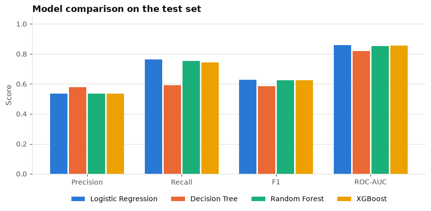
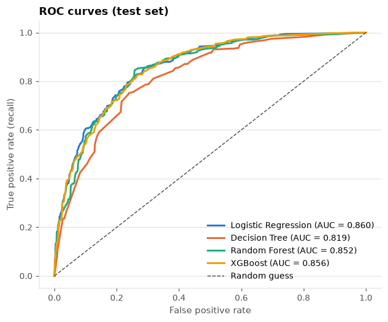
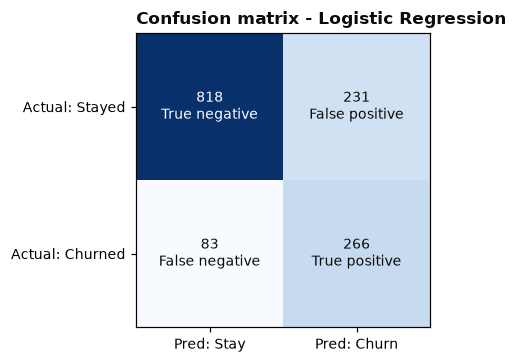
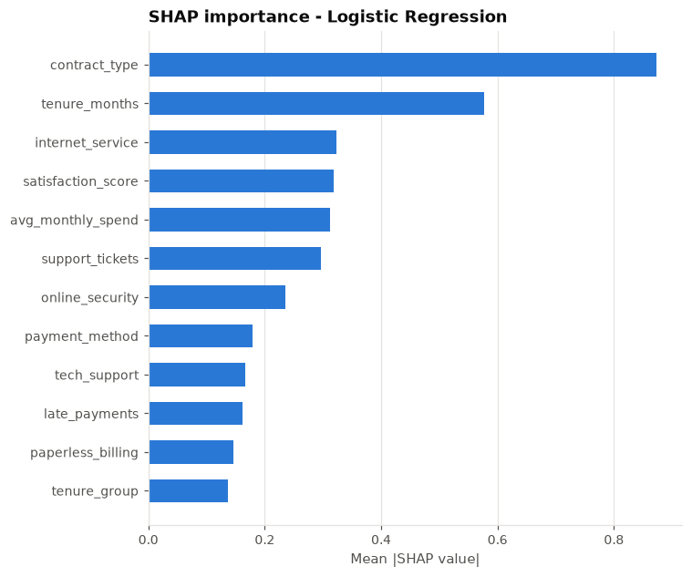

# Customer Churn Prediction: ML Customer Retention Analytics

An end-to-end machine learning project that predicts **which customers are likely to churn**, explains **why**, and suggests **retention actions**. It includes an interactive Streamlit dashboard.

It covers the full workflow, from messy raw data to explainable predictions and business recommendations:

```
Raw data → Cleaning → EDA → Feature engineering → Stratified train/test split
→ 4 models → Cross-validation & tuning → Evaluation & comparison
→ Churn probability + risk category → Explainable AI (SHAP) → Business insights → Dashboard
```

> **Data notice:** the project uses a **synthetic** dataset that the project generates itself. Every customer is fictional, and the data contains no real personal information. See [Dataset](#5-dataset-information).



---

## Table of contents

1. [Project overview](#1-project-overview)
2. [Problem statement](#2-problem-statement)
3. [Business motivation](#3-business-motivation)
4. [Features](#4-features)
5. [Dataset information](#5-dataset-information)
6. [Machine learning workflow](#6-machine-learning-workflow)
7. [Algorithms used](#7-algorithms-used)
8. [Model evaluation methodology](#8-model-evaluation-methodology)
9. [Results](#9-results)
10. [Explainable AI approach](#10-explainable-ai-approach)
11. [Preventing data leakage](#11-preventing-data-leakage)
12. [Project structure](#12-project-structure)
13. [Installation (Windows, macOS, Linux)](#13-installation)
14. [How to train the models](#14-how-to-train-the-models)
15. [How to run the Streamlit dashboard](#15-how-to-run-the-streamlit-dashboard)
16. [How to run the tests](#16-how-to-run-the-tests)
17. [Example prediction workflow](#17-example-prediction-workflow)
18. [ML concepts explained (beginner-friendly)](#18-ml-concepts-explained)
19. [Reproducibility](#19-reproducibility)
20. [Limitations](#20-limitations)
21. [Future improvements](#21-future-improvements)

---

## 1. Project overview

The project trains and compares **four classification models**: Logistic Regression, Decision Tree, Random Forest and XGBoost. Each one estimates the probability that a customer will leave (churn). The primary model is chosen on **cross-validated ROC-AUC**, not on accuracy. Its predictions are explained with **SHAP** and permutation importance and turned into **Low / Medium / High risk** categories. **Rule-based retention recommendations** are attached to each prediction.

## 2. Problem statement

> Given a customer's profile, contract, billing, service and support history, estimate the probability that they will churn, and identify which factors drive that estimate.

This is a **binary classification** problem. The target is `churn` (1 = churned, 0 = stayed). The classes are **imbalanced**: about 25% of customers churn.

## 3. Business motivation

Winning a new customer usually costs much more than keeping an existing one. If a company can find at-risk customers early, it can focus retention budget (discounts, support calls, contract offers) on the people most likely to leave, rather than spreading it across everyone. The model gives a **ranked list of at-risk customers** and says **why each one is at risk**, so retention teams can act in a targeted way.

## 4. Features

| Area | What you get |
|---|---|
| **Data cleaning** | Handles missing values, duplicates, wrong data types, invalid numbers, inconsistent category spellings, blank strings and unparseable dates, and produces a cleaning report |
| **EDA** | Churn by contract, tenure, monthly charges, payment method, services, segments, signup year, and a correlation matrix (notebook and dashboard) |
| **Feature engineering** | Tenure groups, age groups, service count, average monthly spend, charge-increase ratio, new-customer flag, streaming flag, protection bundle |
| **4 models** | Logistic Regression, Decision Tree, Random Forest, XGBoost, all as leakage-safe scikit-learn pipelines |
| **Tuning** | 5-fold stratified cross-validation and randomized hyperparameter search for the three strongest models |
| **Evaluation** | Accuracy, Precision, Recall, F1, ROC-AUC, confusion matrices, ROC curves, train-vs-test overfitting check |
| **Prediction** | Churn prediction, churn probability and risk category for a single customer (form) or many (CSV upload) |
| **Explainable AI** | Model-native importance, permutation importance, global SHAP importance and a local SHAP explanation per customer |
| **Business insights** | Insights computed from the data, and predicted risk by segment |
| **Recommendations** | Rule-based retention actions, flagged when SHAP confirms the related factor drives that customer's risk |
| **Dashboard** | 8-tab Streamlit app with metrics, charts, filters, downloads, loading states and friendly empty/error states |
| **Tests** | 43 pytest tests covering cleaning, preprocessing, predictions, evaluation, explanations and the dashboard |

## 5. Dataset information

| | |
|---|---|
| **File** | `data/customer_churn.csv` |
| **Type** | **Synthetic** (generated by `src/generate_data.py` with `random_state=42`) |
| **Rows** | 7,042 raw rows → 6,986 after cleaning |
| **Churn rate** | ≈ 25% |
| **Personal data** | None. IDs are sequential labels (`CUST-00001`). There are no names, emails, phone numbers or addresses |

**Why synthetic?** The request was for data that could be included legally and reliably. Popular public churn datasets have unclear redistribution licences, and they lack some of the requested attributes (age, satisfaction, support usage). The generator produces telecom-style data with plausible relationships: for example, month-to-month contracts, short tenure, fiber internet, electronic-check payment, many support tickets and low satisfaction all raise churn likelihood. It also **deliberately injects data-quality problems** so that the cleaning step does real work: ~1–2% missing values, 42 duplicate rows, inconsistent spellings such as `MTM` or `Fibre`, impossible values such as age 999 or negative charges, blank `total_charges` strings, bad dates and unknown labels.

Regenerate it at any time with `python src/generate_data.py`.

**Columns**

| Column | Type | Description |
|---|---|---|
| `customer_id` | id | Fictional identifier (not used as a feature) |
| `signup_date` | date | Signup date (used for EDA only) |
| `gender`, `partner`, `dependents`, `region` | categorical | Profile |
| `age` | numeric | Age in years |
| `tenure_months` | numeric | Months as a customer |
| `contract_type` | categorical | Month-to-month / One year / Two year |
| `payment_method` | categorical | Electronic check / Mailed check / Bank transfer / Credit card |
| `paperless_billing` | categorical | Yes / No |
| `internet_service` | categorical | DSL / Fiber optic / No |
| `phone_service`, `online_security`, `online_backup`, `device_protection`, `tech_support`, `streaming_tv`, `streaming_movies` | categorical | Subscribed services (Yes / No) |
| `monthly_charges`, `total_charges` | numeric | Billing ($) |
| `support_tickets` | numeric | Support tickets in the last 12 months |
| `satisfaction_score` | numeric | 1 (very unhappy) – 5 (very happy) |
| `late_payments` | numeric | Late payments in the last 12 months |
| `churn` | target | Yes / No |

### Data-cleaning decisions

All of these are implemented in `src/data_processing.py`. Each change is counted in a **cleaning report** that is shown in the dashboard.

1. **Whitespace and blanks:** text is stripped, and empty strings become missing values.
2. **Inconsistent categories** are mapped to one canonical spelling (`MTM`, `month to month` → `Month-to-month`; `F` → `Female`; `Fibre` → `Fiber optic`). Values that cannot be recognised are **set to missing rather than guessed**.
3. **Wrong data types:** numeric columns are converted to numbers, and non-numeric text becomes missing.
4. **Invalid numbers:** values outside a plausible range (age outside 18–100, negative charges, satisfaction outside 1–5) are treated as data-entry errors and set to missing. **The customer row is kept.**
5. **`total_charges` blanks for customers with 0 months of tenure** are set to 0, because those customers haven't been billed yet. This is a fixed business rule, not a learned statistic.
6. **Remaining missing values are not filled during cleaning.** They are imputed inside the model pipeline (median for numbers, most frequent value for categories), using statistics learned from the **training split only**.
7. **Duplicates:** exact duplicate rows (export artefacts) are removed, and for repeated customer IDs the first record is kept.
8. **Unknown churn labels:** these rows are removed from training, because a model can't learn from an unknown outcome. They are counted and reported, never dropped silently.
9. **Dates:** `signup_date` is parsed, and unparseable dates become missing. The date is used for EDA but **not** as a feature, because it duplicates tenure and would tie the model to one snapshot date.

## 6. Machine learning workflow

```
data/customer_churn.csv
        │  src/data_processing.py   (clean + report)
        ▼
cleaned DataFrame ──► stratified 80/20 split (random_state=42)
        │                      │
        │ TRAIN (5,588)        │ TEST (1,398): locked until final evaluation
        ▼                      │
Pipeline per model:            │
  FunctionTransformer(engineer_features)   ← fixed row-wise rules
  ColumnTransformer                        ← fitted on training folds only
     ├─ numeric: median imputer → StandardScaler
     └─ categorical: most-frequent imputer → OneHotEncoder(handle_unknown="ignore")
  Classifier
        │
        ├─ 5-fold stratified CV of 4 baseline models
        ├─ RandomizedSearchCV (20 candidates × 5 folds) for the 3 strongest
        ├─ decision threshold = max F1 on out-of-fold training predictions
        ├─ fit on full training set
        ▼
Evaluate on TEST ─► comparison table, ROC curves, confusion matrices
        ▼
Primary model = highest CV ROC-AUC ─► SHAP + permutation importance
        ▼
models/*.joblib + models/evaluation.json ─► Streamlit dashboard (loads, never retrains silently)
```

**Feature engineering** (`src/feature_engineering.py`):

| Feature | Definition |
|---|---|
| `tenure_group` | 0–12, 13–24, 25–48, 49+ months |
| `age_group` | 18–29, 30–44, 45–59, 60+ |
| `service_count` | Number of subscribed services (internet + phone + add-ons) |
| `avg_monthly_spend` | `total_charges / tenure_months` (historical average bill) |
| `charge_increase_ratio` | Current monthly charge ÷ historical average bill |
| `is_new_customer` | 1 if tenure ≤ 6 months |
| `has_streaming` | 1 if the customer streams TV or movies |
| `has_protection_bundle` | 1 if the customer has both online security and tech support |

Categorical variables are **one-hot encoded** inside the pipeline.

**Class imbalance.** Resampling and class weights were **deliberately not used**, because re-weighting inflates predicted probabilities: a 25% base rate would look like ~50%. That would make the "churn probability" shown to users misleading. Instead the project uses:

- a stratified split and stratified CV folds
- imbalance-aware metrics (precision, recall, F1, ROC-AUC)
- a per-model **decision threshold** that maximises F1 on out-of-fold *training* predictions (≈ 0.28–0.34 instead of 0.5)

As a result, the average predicted probability (24.9%) matches the real churn rate (24.9%).

## 7. Algorithms used

| Model | Why it was used |
|---|---|
| **Logistic Regression** | A strong, fast, **interpretable baseline**. It models the log-odds of churn as a weighted sum of the features, so each coefficient shows the direction and strength of an effect. It works well when relationships are roughly additive, and its probabilities are usually well calibrated. |
| **Decision Tree** | Learns human-readable **if/then rules** ("if month-to-month and tenure < 12 → high risk") and captures non-linear effects and interactions. A single tree overfits easily, so depth and leaf size are limited. It is included as the simplest non-linear model. |
| **Random Forest** | An **ensemble of many decision trees**, each trained on a bootstrap sample with random feature subsets, whose votes are averaged. This reduces the variance/overfitting of a single tree, handles interactions, and gives feature importances. |
| **XGBoost** | **Gradient boosting**: trees are added one after another, each correcting the errors of the previous ones, with regularisation. It is often the most accurate choice on tabular data and handles non-linearities and interactions well. |

## 8. Model evaluation methodology

- **Hold-out test set:** 20% of customers, stratified by churn, never used for training, tuning, threshold choice or model selection.
- **Cross-validation:** 5-fold stratified CV on the training set compares baselines and tunes hyperparameters.
- **Metrics** on the test set: Accuracy, Precision, Recall, F1, ROC-AUC and the confusion matrix. All of them are **computed by the code** and saved to `models/evaluation.json` and `reports/model_comparison.csv`. **None are hard-coded.**
- **Model selection rule:** the model with the **highest mean CV ROC-AUC** becomes the primary model. If two models are within 0.005, the one with higher CV F1 wins. Accuracy is not used, because with 25% churners a model that always predicts "stay" would be 75% accurate while catching zero churners. Selection uses CV rather than the test set, so the test score remains an unbiased estimate.
- **Overfitting check:** train ROC-AUC is compared with test ROC-AUC.

### False positives vs. false negatives

| | Meaning | Business cost |
|---|---|---|
| **False positive** | Model says *churn*, customer actually *stays* | Retention budget is spent on someone who wasn't leaving (a wasted discount or call) |
| **False negative** | Model says *stay*, customer actually *churns* | A customer is lost who could have been saved. This is usually the more expensive mistake |

- **Precision** is the share of flagged customers who really churn. High precision means little wasted budget.
- **Recall** is the share of real churners who get flagged. High recall means few missed churners.

Retention teams usually favour **recall**, because missing a churner costs more than an unnecessary offer. The tuned thresholds therefore trade some precision for much higher recall. For example, with the Logistic Regression model, recall rises from 0.50 at threshold 0.5 to 0.76 at 0.28, while precision falls from 0.70 to 0.54.

## 9. Results

Test-set results from `python src/train_models.py` (random_state = 42, 1,398 test customers, 25.0% churn). These numbers are produced by the training script and saved in `reports/model_comparison.csv`. Re-running training regenerates them.

| Model | Accuracy | Precision | Recall | F1 | ROC-AUC | Threshold | CV ROC-AUC |
|---|---|---|---|---|---|---|---|
| **Logistic Regression** (primary) | 0.775 | 0.535 | **0.762** | **0.629** | **0.860** | 0.28 | **0.857** ± 0.008 |
| Decision Tree | **0.790** | **0.579** | 0.590 | 0.584 | 0.819 | 0.34 | 0.812 ± 0.004 |
| Random Forest (tuned) | 0.775 | 0.536 | 0.754 | 0.626 | 0.852 | 0.30 | 0.839 ± 0.006 |
| XGBoost (tuned) | 0.775 | 0.536 | 0.745 | 0.624 | 0.856 | 0.29 | 0.852 ± 0.006 |

**Why Logistic Regression was selected:** it has the highest cross-validated ROC-AUC (0.857), slightly ahead of tuned XGBoost (0.852). Note that the **Decision Tree has the highest accuracy and precision but the lowest recall**. It misses 143 of 349 churners, compared with 83 for Logistic Regression, which shows why accuracy alone would pick the wrong model. Random Forest shows the largest overfitting gap (train ROC-AUC 0.95 vs test 0.85).

A simple model winning is a genuine finding, not a failure. Churn in this dataset is driven mainly by additive effects (contract, tenure, services, support experience), which a linear model captures well. The tree ensembles are close behind, and they would likely pull ahead on data with stronger interactions. Real-world data may behave differently.

<p float="left">
  
  
</p>

## 10. Explainable AI approach

| Technique | Scope | What it shows |
|---|---|---|
| **Model-native importance** | Global, every model | Tree models: impurity/gain importance. Logistic Regression: absolute standardised coefficients |
| **Permutation importance** | Global, primary model, **test set** | How much test ROC-AUC drops when one raw feature is shuffled. It is model-agnostic |
| **SHAP (mean \|SHAP\|)** | Global, primary model | Average size of each feature's contribution to predictions |
| **SHAP local explanation** | One customer | Which features pushed *this* prediction up (red) or down (blue) |

One-hot columns are **summed back to their original feature** (e.g. the three `contract_type_*` columns become `contract_type`). This is valid because SHAP values are additive.

The dashboard answers **"Why is this customer considered high risk?"** by listing only the factors whose SHAP contribution actually pushes that customer's prediction towards churn. **No explanation is invented.** Recommendations whose related feature appears among those SHAP drivers are marked *"supported by this customer's SHAP explanation"*.



> ⚠️ Explanations describe **the model**, not the real world. A feature that strongly influences predictions is *associated* with churn in this data. That does not prove it *causes* churn. Correlated features (e.g. `tenure_months`, `total_charges` and `avg_monthly_spend`) can also share or trade importance between them.

## 11. Preventing data leakage

Data leakage happens when information from the test set, or from the future, sneaks into training. It makes results look better than they really are.

- The data is **split before any learned preprocessing**. Imputation medians, scaling means/variances and one-hot category lists are all learned **inside a scikit-learn `Pipeline`/`ColumnTransformer`** that is fitted on training data only. During cross-validation they are re-fitted on each training fold.
- Feature engineering done before the split uses only **fixed, row-wise rules** (e.g. tenure bins at 12/24/48 months, `total_charges / tenure`). Nothing is learned from other rows, so it cannot leak.
- The cleaning step only standardises spellings, converts types and applies fixed validity ranges. It **does not fill values with dataset statistics**.
- The decision threshold is chosen on **out-of-fold training predictions**, never on the test set.
- Model selection uses **cross-validation scores**, never test scores.
- A unit test (`test_preprocessor_learns_only_from_training_rows`) checks that imputation statistics come only from the rows the pipeline was fitted on.

## 12. Project structure

```
Customer-Churn-Prediction/
├── app.py                        # Streamlit dashboard (UI only, logic lives in src/)
├── data/
│   └── customer_churn.csv        # Synthetic dataset (with injected data-quality issues)
├── src/
│   ├── config.py                 # Paths, schema, random seed, risk thresholds
│   ├── generate_data.py          # Synthetic data generator
│   ├── data_processing.py        # Loading, cleaning, cleaning report, upload validation
│   ├── feature_engineering.py    # Engineered features + preprocessing pipeline
│   ├── train_models.py           # Training, CV, tuning, selection, saving  ← run this
│   ├── evaluate_models.py        # Metrics, comparison table, model selection
│   ├── predictions.py            # Load models, score customers, risk categories
│   ├── explainability.py         # Feature importance + SHAP (global & local)
│   ├── insights.py               # Business insights + retention recommendations
│   └── plots.py                  # Matplotlib charts
├── models/                       # Trained artefacts (git-ignored, created by training)
├── notebooks/
│   ├── exploratory_analysis.ipynb
│   └── build_notebook.py         # Regenerates/executes the notebook
├── reports/
│   ├── model_comparison.csv      # Generated by training
│   └── figures/                  # Generated charts used in this README
├── tests/
│   ├── conftest.py
│   ├── test_data_processing.py
│   ├── test_predictions.py
│   └── test_app.py               # Dashboard smoke test (skipped if models not trained)
├── .streamlit/config.toml
├── pytest.ini
├── requirements.txt
├── README.md
└── .gitignore
```

**About model files in Git:** the `models/` folder is git-ignored. Model files are binary, tied to specific library versions, and fully reproducible from the code and data in about 1.5 minutes. After cloning, run `python src/train_models.py` once. If you skip this step, the dashboard shows a **"Train models now"** button.

## 13. Installation

Requirements: **Python 3.10+** (tested with Python 3.11) and Git.

### Windows (PowerShell)

```powershell
git clone https://github.com/haripriyamanga/Customer-Churn-Prediction.git
cd Customer-Churn-Prediction

python -m venv .venv
.\.venv\Scripts\Activate.ps1

pip install -r requirements.txt
```

> If PowerShell says *"running scripts is disabled on this system"*, run this once and then activate again:
> `Set-ExecutionPolicy -Scope CurrentUser -ExecutionPolicy RemoteSigned`
>
> Using Command Prompt (cmd.exe) instead? Activate with `.venv\Scripts\activate.bat`.

### macOS / Linux

```bash
git clone https://github.com/haripriyamanga/Customer-Churn-Prediction.git
cd Customer-Churn-Prediction
python3 -m venv .venv
source .venv/bin/activate
pip install -r requirements.txt
```

**What a virtual environment is:** `.venv` is a private folder of Python packages for this project only, so its libraries don't conflict with other projects. Activate it every time you open a new terminal. You'll see `(.venv)` at the start of the prompt.

## 14. How to train the models

```bash
python src/train_models.py
```

This takes about 1–2 minutes. It cleans the data, cross-validates the 4 models, tunes the 3 strongest, evaluates everything on the test set, selects the primary model, computes SHAP and permutation importance, and saves:

- `models/churn_model.joblib`: the primary pipeline plus metadata (threshold, risk thresholds, reference values)
- `models/all_models.joblib`: all four fitted pipelines
- `models/evaluation.json`: every metric, curve, CV score, best parameters and importance
- `reports/model_comparison.csv` and `reports/figures/*.png`

The data is already included in the repo. To regenerate the synthetic data: `python src/generate_data.py`.

## 15. How to run the Streamlit dashboard

```bash
streamlit run app.py
```

Your browser opens at <http://localhost:8501>. Tabs:

| Tab | Contents |
|---|---|
| 📊 **Overview** | Total customers, churned customers, churn rate, average churn probability, high-risk count, risk distribution, cleaning report |
| 🔍 **Data Exploration** | Churn distribution, churn by segment (selectable), tenure and charges histograms, correlation matrix, signup trend, data previews |
| 🏆 **Model Comparison** | Metrics table, primary-model reasoning, metric bars, ROC curves, 4 confusion matrices, FP vs FN explainer, CV/tuning/overfitting table |
| 🧮 **Customer Prediction** | Form for a customer's details → prediction, probability, risk category, SHAP explanation, suggested actions (choose any of the 4 models) |
| 🧠 **Explainability** | Native importance per model, SHAP and permutation importance, "Why is this customer high risk?" for any test customer |
| 🚨 **High-Risk Customers** | Ranked table with filters (risk, contract, min probability, test-set only, hide churned), sorting, CSV download |
| 💡 **Business Insights** | Insights computed from the data, churn by contract/tenure, predicted risk by segment, recommendation counts |
| 📤 **Batch Scoring (CSV)** | Upload your own CSV → validation (columns, types, missing values, categories) → scoring **without retraining** → download |

**Risk categories** (defined in `src/config.py`):

| Category | Churn probability | Rationale |
|---|---|---|
| 🟢 Low Risk | < 25% | Below the average customer's churn rate |
| 🟡 Medium Risk | 25% – 60% | Above average, which includes each model's "likely to churn" threshold (0.28–0.34) |
| 🔴 High Risk | ≥ 60% | The model sees churn as clearly more likely than not |

A probability is an **estimate, not a certainty**. "70%" means that among customers with similar profiles, the model expects about 7 in 10 to churn.

## 16. How to run the tests

```bash
python -m pytest
```

There are 43 tests, and none of them need an external API:

- **Data loading:** the dataset loads with the expected schema, and cleaned categories are valid
- **Data cleaning:** duplicates, category standardisation, unknown categories, invalid numbers, blank `total_charges`, missing target, date parsing
- **Missing-value handling:** values stay missing through cleaning, are imputed by the pipeline without NaNs, and predictions work with missing or messy inputs
- **Feature preprocessing:** engineered features, one-hot mapping, and a **no-leakage** check of imputation statistics
- **Prediction pipeline:** probabilities within [0, 1], risk thresholds at their exact boundaries, single and batch scoring, unseen categories
- **Evaluation:** metric correctness on a known example, selection by CV ROC-AUC rather than accuracy
- **Explainability:** importance aggregation, and SHAP additivity (base value + contributions = model output)
- **Insights and recommendations:** rates match manual calculations, rules fire correctly
- **Dashboard smoke test:** the whole Streamlit app runs and makes a prediction (skipped if models aren't trained)

## 17. Example prediction workflow

1. `streamlit run app.py` → open the **🧮 Customer Prediction** tab.
2. Enter a customer: 5 months tenure, month-to-month contract, electronic check, fiber optic, $85/month, 3 support tickets, satisfaction 3/5.
3. Click **Predict churn risk**. With the trained Logistic Regression, the result is **"Likely to churn", about 86% probability, 🔴 High Risk**.
4. **Why this prediction?** The SHAP chart shows that the month-to-month contract and short tenure push the risk up most, followed by average spend, fiber optic, electronic check and support tickets.
5. **Suggested retention actions:** early engagement (short tenure), pricing review (charges in the top 25%), support follow-up (3 tickets), contract-upgrade incentive, automatic payment, tech-support trial. Each one is marked when the SHAP explanation supports it.

In code:

```python
from src.predictions import load_primary_model, predict_single

bundle = load_primary_model()
customer = {"gender": "Female", "age": 35, "partner": "No", "dependents": "No", "region": "East",
            "tenure_months": 5, "contract_type": "Month-to-month", "payment_method": "Electronic check",
            "paperless_billing": "Yes", "internet_service": "Fiber optic", "phone_service": "Yes",
            "online_security": "No", "online_backup": "No", "device_protection": "No",
            "tech_support": "No", "streaming_tv": "Yes", "streaming_movies": "No",
            "monthly_charges": 85.0, "total_charges": 425.0, "support_tickets": 3,
            "satisfaction_score": 3, "late_payments": 1}
result = predict_single(bundle["pipeline"], customer, bundle["classification_threshold"])
print(result["prediction"], f"{result['probability']:.1%}", result["risk_category"])
```

## 18. ML concepts explained

- **Classification:** predicting a category (here churn vs. no churn). Models output a **probability**, and a **threshold** turns that probability into a yes/no label.
- **Overfitting:** when a model memorises the training data, noise included, and does worse on new data. The sign is a high training score with a lower test score. The project limits it with tree-depth/leaf limits, regularisation, cross-validation and a train-vs-test check.
- **Feature engineering:** creating more informative inputs from raw columns, such as tenure groups or average monthly spend, so patterns are easier for models to learn.
- **Class imbalance:** one class (churners, 25%) is much rarer than the other. Accuracy then becomes misleading, so precision, recall, F1 and ROC-AUC are used, together with a tuned decision threshold.
- **Precision:** of all customers predicted to churn, the fraction who really churned. It answers "how many of our retention offers go to the right people?"
- **Recall:** of all customers who really churned, the fraction we caught. It answers "how many leavers did we spot?"
- **F1-score:** the harmonic mean of precision and recall. It is high only when both are high.
- **ROC-AUC:** the probability that the model ranks a random churner above a random non-churner. 0.5 is random guessing and 1.0 is perfect. It does not depend on the threshold.
- **Cross-validation:** the training data is split into 5 folds, the model trains on 4 and is tested on the 5th, and this repeats 5 times. Averaging the results gives a more reliable estimate than a single split, without touching the test set.
- **Hyperparameter tuning:** trying different model settings (tree depth, learning rate, regularisation) and keeping the ones with the best cross-validated score.
- **Feature importance:** a global measure of how much each feature contributes to a model's predictions, based on impurity reduction, coefficient size or the performance drop when the feature is shuffled.
- **SHAP (SHapley Additive exPlanations):** a game-theory method that splits a single prediction into per-feature contributions. Each contribution says how much that feature moved the prediction away from the average, and the contributions add up exactly to the model's output.

## 19. Reproducibility

| Item | Setting |
|---|---|
| Dataset | `data/customer_churn.csv`, synthetic, regenerated by `src/generate_data.py` (seed 42) |
| Random state | `RANDOM_STATE = 42` (split, CV folds, models, searches, SHAP sampling) in `src/config.py` |
| Split | 80/20 stratified train/test split |
| CV | 5-fold `StratifiedKFold(shuffle=True, random_state=42)` |
| Models | Logistic Regression, Decision Tree, Random Forest, XGBoost |
| Tuning | `RandomizedSearchCV`, 20 candidates, scoring = ROC-AUC, for the 3 best baselines |
| Metrics | Accuracy, Precision, Recall, F1, ROC-AUC, confusion matrix, on the test set |
| Selection | Highest mean CV ROC-AUC (tie-break: CV F1) |

Running `python src/train_models.py` twice gives identical metrics. Small differences are possible across library versions or operating systems.

## 20. Limitations

- **Synthetic data:** the patterns are plausible but artificial, so the results show the *workflow* and don't say anything about any real business. A real dataset would bring messier signals, concept drift and possibly lower scores.
- **Associations, not causes:** neither the EDA nor SHAP proves that a factor causes churn. Measuring whether a retention action works needs an experiment, such as an A/B test.
- **Snapshot model:** the model sees one point in time and doesn't model *when* a customer will churn. Survival analysis would address this.
- **Threshold choice:** thresholds maximise F1. A real business should set them from the actual costs of false positives and false negatives.
- **In-sample scores in the dashboard:** the Overview and High-Risk tables score all customers, and 80% of them were used for training. The "test-set only" filter shows honest out-of-sample scores.
- **Rule-based recommendations** are simple heuristics. They are suggestions, not guaranteed solutions.
- **CSV uploads** must follow this dataset's schema.

## 21. Future improvements

- Validate on a real, properly licensed dataset (e.g. with its licence documented)
- Cost-sensitive threshold selection that uses customer lifetime value
- Probability calibration analysis (reliability curves, Brier score)
- Survival analysis to estimate *time to churn*
- Uplift modelling, to find customers most likely to respond to an offer
- An MLflow experiment-tracking and model registry
- Scheduled retraining with data-drift monitoring
- Containerisation (Docker) and cloud deployment
- CI pipeline (GitHub Actions) that runs the tests on every push

---

*Built with Python, pandas, scikit-learn, XGBoost, SHAP, Matplotlib and Streamlit. All data is synthetic.*
